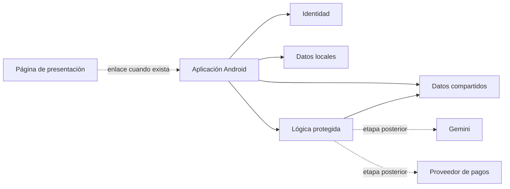

# Arquitectura de TuEmpuje

La arquitectura organiza la aplicación móvil, la página de presentación y los servicios alrededor de un recorrido compartido

Un cliente publica una oportunidad desde Android, otra persona la consulta y postula desde la misma aplicación y ambos pueden seguir el estado de la postulación

La página web presentará TuEmpuje y dirigirá a las personas a la aplicación cuando exista un enlace disponible

## Estado

Este documento presenta la arquitectura prevista para la primera versión

Las aplicaciones y servicios todavía no están implementados

## Componentes

| Componente | Responsabilidad | Tecnología propuesta |
|---|---|---|
| Android | Publicar y consultar oportunidades, postular y seleccionar candidatos | Kotlin y Jetpack Compose |
| Página de presentación | Explicar el proyecto y dirigir a la aplicación | Tecnología por definir |
| Identidad | Autenticar cuentas y gestionar sesiones | Firebase Authentication |
| Datos compartidos | Conservar oportunidades, perfiles y postulaciones | Cloud Firestore |
| Datos locales | Mantener favoritos y datos locales definidos | Room sobre SQLite |
| Operaciones protegidas | Validar acciones que requieran lógica de servidor | Cloud Functions o servicio equivalente |
| Asistencia | Proponer borradores editables para publicaciones | Gemini, en una etapa posterior |
| Pagos | Gestionar transacciones mediante un proveedor | Por definir, después del flujo principal |

## Vista general



El diagrama representa una propuesta de organización

La configuración concreta de acceso directo a Firestore y de funciones de servidor se definirá al implementar cada operación

## Aplicación Android

La interfaz se construirá con Compose y mantendrá separados los componentes visuales, el estado de pantalla y el acceso a datos

```text
Pantalla Compose
      ↓ acciones
ViewModel
      ↓ solicitudes
Repositorio
      ├── datos compartidos
      ├── datos locales
      └── API HTTP, cuando exista una necesidad concreta
```

Las acciones del usuario actualizan el estado que observa la interfaz

El repositorio coordina las fuentes de datos para que la pantalla no dependa directamente de su implementación

La [guía de arquitectura Android](https://developer.android.com/topic/architecture/recommendations) describe estas responsabilidades y el flujo unidireccional de datos

## Datos compartidos y locales

Firestore es la opción propuesta para compartir información entre las cuentas que utilizan Android

La página de presentación no requiere acceso a cuentas, publicaciones ni postulaciones para cumplir su función inicial

Room se plantea para conservar oportunidades guardadas y otras consultas locales que se definan durante el desarrollo

Firestore también dispone de persistencia local, por lo que cada repositorio deberá definir qué datos guarda en cada fuente y cómo los actualiza

Una publicación guardada sin conexión puede estar desactualizada

Las postulaciones y selecciones solo se muestran como confirmadas después de recibir la confirmación correspondiente del servicio

## Identidad y permisos

Una cuenta puede actuar como postulante o cliente según la acción que realice

La interfaz no determina por sí sola quién puede leer postulaciones, seleccionar candidatos o administrar reportes

Las reglas de datos y la lógica protegida deben comprobar la identidad, la propiedad de cada recurso y el estado permitido para cada operación

Las bibliotecas de servidor de Firestore pueden omitir las reglas de seguridad del cliente, por lo que las funciones administrativas requieren sus propias comprobaciones de autorización y permisos de servicio

## Operaciones principales

| Operación | Responsable | Condición principal |
|---|---|---|
| Publicar oportunidad | Cliente | Completar los campos obligatorios y guardar la publicación bajo su cuenta |
| Consultar oportunidades | Postulante | Acceder únicamente a las publicaciones disponibles |
| Postular | Postulante | Evitar una segunda postulación activa a la misma oportunidad |
| Revisar candidatos | Cliente | Consultar únicamente las postulaciones de sus publicaciones |
| Seleccionar candidato | Cliente | Respetar el número de vacantes y registrar la selección |

Las selecciones simultáneas deben resolverse de forma atómica para evitar que se ocupen más vacantes de las disponibles

## Inteligencia artificial y pagos

Gemini se plantea como asistencia para redactar oportunidades a partir de una descripción proporcionada por el cliente

La respuesta será un borrador editable y los campos sin información permanecerán pendientes

La evaluación de un modelo propio de categorías se documenta en el [plan de inteligencia artificial](06-plan-inteligencia-artificial.md)

Los pagos se integrarán después del recorrido principal y tendrán estados independientes de los trabajos y postulaciones

## Decisiones iniciales

| Decisión | Motivo | Revisión pendiente |
|---|---|---|
| Mantener Android y la página de presentación en el mismo repositorio | Facilitar el seguimiento del proyecto y su documentación | Revisar su organización cuando existan ambos componentes |
| Usar una arquitectura Android por responsabilidades | Mantener claras las funciones de interfaz, estado y datos | Ajustar el número de módulos al tamaño real |
| Concentrar el recorrido en Android | Permitir que clientes y postulantes utilicen la misma aplicación | Confirmar configuración y condiciones de Firebase |
| Destinar la web a presentación | Explicar el proyecto y facilitar el acceso a la aplicación | Definir la página y el enlace de descarga cuando corresponda |
| Reservar las operaciones sensibles al sistema confiable | Proteger permisos, vacantes y datos privados | Definir las reglas y funciones específicas |
| Posponer pagos | Completar y probar primero la publicación y postulación | Evaluar proveedor, costos y condiciones de operación |

## Referencias

- [Now in Android](https://github.com/android/nowinandroid) para organización de una aplicación Android con Kotlin y Compose
- [Immich](https://github.com/immich-app/immich) para separación de aplicaciones, servicios y documentación en un repositorio compartido
- [Recomendaciones de arquitectura Android](https://developer.android.com/topic/architecture/recommendations)
- [Reglas de seguridad de Firestore](https://firebase.google.com/docs/firestore/security/get-started)
