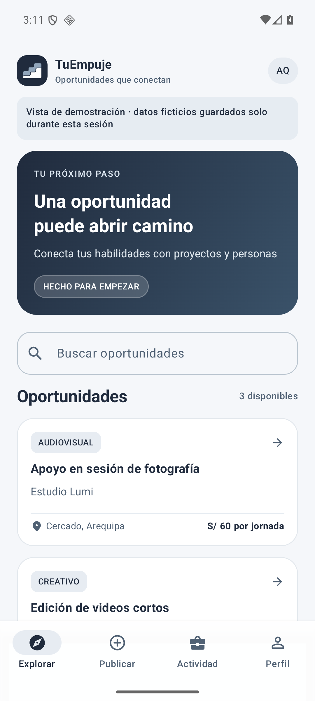
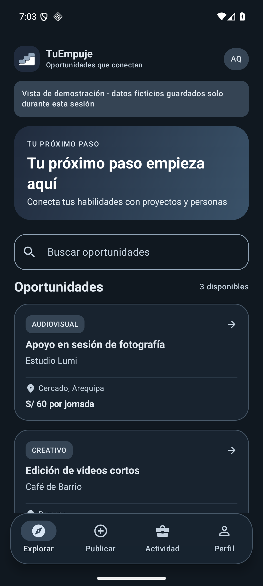

# Diseño y navegación de TuEmpuje

Este documento define la dirección visual y las reglas de interacción previstas para la aplicación Android

Los componentes y recorridos descritos se incorporarán por etapas y su presencia en este documento no implica que ya estén implementados

Las capturas corresponden al prototipo Android en modo claro y oscuro, con datos ficticios en memoria




## Dirección visual

TuEmpuje usa como base el azul noche `#202B3D` y el gris azulado `#506174`, elegidos junto con el símbolo de los escalones

La interfaz buscará comunicar profundidad mediante capas bien separadas, superficies translúcidas, bordes discretos y sombras suaves

El contenido de cada oportunidad conservará una superficie legible y estable para que el título, las condiciones y el pago se puedan consultar con facilidad

El prototipo utiliza `MaterialExpressiveTheme` de Material 3 `1.5.0-alpha18`, una versión preliminar que requiere dependencias de Compose también preliminares y debe revisarse antes de una publicación real

Se eligió esta versión para conservar la configuración actual de Android y probar la dirección visual, las versiones posteriores se evaluarán junto con sus requisitos de SDK y Gradle [Versiones de Material 3](https://developer.android.com/jetpack/androidx/releases/compose-material3)

El tema define colores para apariencia clara y oscura, tipografía y formas compartidas, mientras que la barra inferior utiliza una superficie translúcida sin desenfoque real de fondo

### Referencia de Liquid Glass

La propuesta toma como referencia los criterios de [materiales de Apple](https://developer.apple.com/design/human-interface-guidelines/materials), que sitúan los controles flotantes en una capa diferente del contenido y recomiendan limitar los efectos para preservar la jerarquía y la legibilidad

Liquid Glass pertenece a las plataformas de Apple y no es un componente nativo de Android, por lo que TuEmpuje desarrollará una interpretación visual propia con herramientas de Jetpack Compose

La transparencia podrá aplicarse a la navegación y a controles flotantes, mientras que la información principal se presentará con contraste suficiente y sin depender del efecto

### Compatibilidad del desenfoque

En Compose, `Modifier.blur` desenfoca el contenido del propio componente y sus elementos hijos, no el contenido que se encuentra detrás de él

El desenfoque uniforme requiere Android 12 o superior y en versiones anteriores el efecto no se aplica, según la [documentación de Android](https://developer.android.com/develop/ui/compose/graphics/blur/overview)

La primera versión puede utilizar transparencia, color y bordes sin afirmar que se trata de un desenfoque de fondo real

Si más adelante se incorpora desenfoque del contenido situado detrás de un panel, se evaluarán primero la técnica, compatibilidad, consumo y legibilidad en dispositivos de prueba

Cuando la transparencia reduzca la lectura o un dispositivo no admita el efecto previsto, la interfaz deberá contar con una superficie más opaca y contrastada

## Navegación principal

La aplicación contempla cuatro destinos principales al mismo nivel, una cantidad compatible con la [recomendación de navegación móvil de Android](https://developer.android.com/design/ui/mobile/guides/layout-and-content/layout-and-nav-patterns)

| Destino | Función prevista | Acciones principales |
|---|---|---|
| Explorar | Descubrir oportunidades disponibles | Buscar, filtrar, abrir una oportunidad y revisar sus condiciones |
| Publicar | Crear una oportunidad para una tarea o ayudantía | Completar el formulario, revisar datos y publicar cuando exista conexión y autorización |
| Actividad | Seguir la participación del usuario | Consultar postulaciones y publicaciones propias, revisar candidatos y estados |
| Perfil | Administrar la información de la cuenta | Iniciar o cerrar sesión y editar el nombre, las habilidades están previstas |

Una misma cuenta podrá publicar y postular, siempre que cumpla las condiciones de cada acción

El detalle de una oportunidad, el formulario de postulación y la revisión de candidatos serán pantallas secundarias asociadas al recorrido correspondiente

### Revisión del flujo actual

| Etapa | Disponible en la app | Falta para completar el recorrido |
|---|---|---|
| Cuenta | Registro, acceso y perfil con Firebase de desarrollo, vista previa de habilidades y disponibilidad | Guardado del perfil ampliado, acceso con Google, recuperación de contraseña y eliminación de cuenta |
| Explorar | Búsqueda y filtros de categoría sobre datos ficticios | Listado compartido, filtros conectados, paginación y estados de red |
| Oportunidad | Detalle con tareas, condiciones, requisitos y vacantes | Identidad verificable de quien publica y datos provenientes del servidor |
| Publicar | Formulario y validaciones en memoria con tipo, tareas, requisitos y condiciones | Guardado en Firestore, edición, cierre y confirmación con datos reales |
| Postular | Confirmación de simulación local y estado visible en Actividad | Envío autenticado, prevención de duplicados y seguimiento compartido |
| Candidatos | Vista de diseño con perfiles ficticios claramente identificados | Consulta autorizada, perfil público mínimo y selección segura |
| Finalizar | No disponible | Acuerdo, finalización, reporte y soporte |

El botón de Google se muestra desactivado hasta implementar su autenticación, los ejemplos de candidatos no representan postulaciones reales

El tema existente usa Material 3 Expressive, los filtros, superficies y botones mantienen sus estados y colores compartidos, la revisión visual y de accesibilidad continúa abierta antes de considerar completo el sistema de diseño [Material 3 en Compose](https://developer.android.com/develop/ui/compose/designsystems/material3)

### Componentes compartidos

| Componente | Uso |
|---|---|
| Aviso | Identificar datos ficticios, entorno de prueba y errores con texto e icono |
| Estado vacío | Explicar que no hay resultados o actividad y ofrecer una acción para continuar |
| Estado de carga | Mostrar que se está consultando la cuenta |
| Botón principal | Mantener una altura mínima de 52 dp y una forma coherente |
| Confirmación | Comunicar el resultado de publicaciones y postulaciones simuladas |
| Campos y filtros | Etiquetas, errores y estados de selección con componentes Material 3 |

Los componentes compartidos están en `ui/components/AppComponents.kt`, las tarjetas de oportunidades utilizan el mismo diseño en Explorar y Actividad

### Recorrido principal

```text
Publicar → formulario → confirmar → oportunidad disponible
                                        ↓
Explorar → detalle → revisar condiciones → postular
                                        ↓
Actividad → revisar candidatos → seleccionar → consultar estado
```

El botón Atrás debe devolver a la pantalla anterior sin producir acciones adicionales, siguiendo los [principios de navegación de Android](https://developer.android.com/guide/navigation/principles)

Los formularios conservarán la información introducida cuando se muestre un error recuperable y solicitarán confirmación antes de descartar cambios relevantes

## Estados y comportamiento

| Situación | Comportamiento previsto |
|---|---|
| La cuenta está cargando | Mostrar una señal de carga y desactivar el formulario mientras termina la operación |
| No hay oportunidades | Explicar que no se encontraron resultados y permitir limpiar la búsqueda y los filtros |
| Falla la cuenta o la conexión | Mostrar el error y permitir reintentar cuando corresponda, conservando el formulario |
| El formulario tiene campos inválidos | Mostrar un resumen, señalar los campos y volver al inicio sin borrar lo ingresado |
| Una acción requiere iniciar sesión | Explicar la necesidad de acceso antes de intentar publicar o postular |
| Se envía una postulación o selección | Mostrar confirmación solo cuando el servicio haya aceptado la operación |
| Se usan datos de ejemplo | Identificar la demostración y evitar presentarla como una operación real |

Cada botón visible debe conducir a una acción disponible o comunicar claramente que la función todavía está en preparación

## Accesibilidad y adaptación

- Mantener zonas táctiles de al menos 48 × 48 dp y etiquetas comprensibles, siguiendo las [recomendaciones de accesibilidad de Compose](https://developer.android.com/codelabs/jetpack-compose-accessibility)
- Comprobar contraste sobre el fondo efectivo, incluidos los paneles translúcidos, en apariencia clara y oscura
- Verificar que el tamaño de texto ampliado no oculte condiciones ni controles
- Usar texto e iconos para comunicar estados, sin depender únicamente del color
- Probar la navegación con TalkBack y el botón Atrás del sistema
- Mantener el movimiento discreto y ofrecer alternativas cuando las preferencias del sistema reduzcan las animaciones
- Adaptar la distribución a distintos tamaños de pantalla y evitar tapar información con barras flotantes o el teclado

## Herramientas de trabajo

La primera etapa utilizará Android Studio, Jetpack Compose y Material 3

Las vistas previas de Compose, el emulador y las pruebas en dispositivos permitirán revisar la interfaz a medida que se construya

En el emulador se comprobaron ambas apariencias, texto ampliado en el inicio, navegación entre secciones, conservación del borrador y retorno desde el detalle con la búsqueda activa

La navegación utiliza transiciones breves de opacidad y el aviso de validación aparece con `AnimatedVisibility`, las animaciones de Compose siguen la escala de duración del sistema [Animaciones en Compose](https://developer.android.com/develop/ui/compose/animation/quick-guide)

No se utiliza una biblioteca externa de desenfoque, el contenido y la navegación se limitan a 600 dp de ancho para mantener la legibilidad en pantallas amplias

Con una escala de texto de 1,8 o más, la navegación se distribuye en dos filas para que las etiquetas puedan leerse en una pantalla estrecha

### Verificación de la interfaz

- En un emulador Android 36 se revisaron Explorar, el detalle, Publicar, Actividad y la vista de candidatos con datos ficticios
- Se comprobaron búsqueda sin resultados, recuperación de filtros, error del formulario, conservación del borrador y publicación simulada
- Se verificó el error de conexión de la cuenta y la conservación de los datos escritos al intentar iniciar sesión sin red
- Se revisó el inicio en oscuro con texto al 150 % y al 200 %, se abrió el perfil al 200 % y se comprobó que el formulario puede desplazarse hasta el botón al 200 %
- Se verificaron las áreas táctiles de la navegación y el botón de publicación en la pantalla estrecha con texto al 200 %, y se revisó el inicio en una pantalla amplia
- Se comprobó la navegación con la duración de animación del sistema en cero y las combinaciones principales de texto y fondo de los temas claro y oscuro

Estas comprobaciones no sustituyen una revisión manual con TalkBack ni pruebas en teléfonos físicos y versiones adicionales de Android, la revisión de los demás recorridos con texto ampliado sigue pendiente

## Prioridad de construcción

Con el plazo académico disponible se priorizarán la navegación básica, el listado, el detalle, la publicación y los estados necesarios para demostrar el recorrido

Los efectos avanzados, la adaptación a más formatos de pantalla y las mejoras visuales se incorporarán después de validar que las acciones principales funcionan
